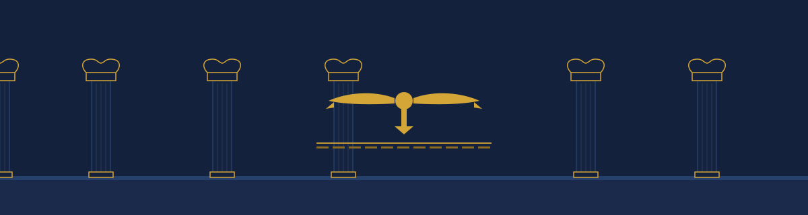

# Prime-OS



*A gaming Linux built to the proportions of Persepolis: stone calm, lapis and gold, nothing shouting.*

**English** · [Français](README.fr.md) · [العربية](README.ar.md) · [Español](README.es.md) · [Deutsch](README.de.md) · [Farsi](README.fa.md) · [Italiano](README.it.md) · [Português](README.po.md) · [Русский](README.ru.md) · [中文](README.zh.md)

> [!CAUTION]
> **Read [NOTICE.md](NOTICE.md) before you download, build, mirror or redistribute anything.** Prime-OS
> is an unaffiliated, unfinished prototype: no proprietary software or drivers are redistributed,
> nothing is guaranteed to work, and a wrong drive selection or a misused tool can destroy data.

**Prime-OS** is a community-built gaming Linux project based on **Arch Linux** and the
[Hyprland](https://hyprland.org/) Wayland compositor, with a visual language borrowed from
Achaemenid Persepolis — see [branding/BRAND.md](branding/BRAND.md). The current milestone is a **bootable live
ISO prototype** — not a finished installer and not a production-ready operating system.

> [!IMPORTANT]
> Nothing in this repository replaces your operating system. The setup app downloads a live image
> and saves a preferences file; it does not repartition a disk, write a USB drive, or install
> Prime-OS. Test the image in a virtual machine first, and use a spare USB drive if you test on
> real hardware.

## Start here

One command downloads the wizard, verifies every file, and opens the setup window. No Linux, no
Docker, no manual build.

### Windows (PowerShell)

```powershell
irm https://raw.githubusercontent.com/fem-dev/Prime-OS/bcfda5806544b362ac89c6986cb44ec78e48f748/install.ps1 | iex
```

> [!TIP]
> **If the command stops with a network error** (`Unable to connect to the remote server`,
> `Could not connect to server`, or a timeout), the problem is the connection to GitHub, not the
> script: **turn on a VPN and run the command again**. If a VPN is already on and it still fails,
> **turn the VPN off** (or change servers) and retry — some VPNs, DNS filters and corporate networks
> block `raw.githubusercontent.com` and `github.com`. Then open `https://github.com` in a browser to
> confirm the connection works, and run the same command again.

### Linux and macOS

```bash
curl -fsSL https://raw.githubusercontent.com/fem-dev/Prime-OS/main/install.sh | bash
```

Requirements: **Python 3 with Tk**, **curl**, an internet connection, and room for the image on
disk. Git is not needed. The installer downloads four files from a **pinned commit**, verifies the
SHA-256 of every one of them, and only adds **Pillow** to a private virtual environment.

## Download source

Prime-OS has exactly **one** official download source: the project's own **GitHub releases**. There
is no mirror and no third-party host, so an image can only come from the repository that publishes
its SHA-256. The wizard shows that source card before writing any byte; press **Enter** to start or
**Esc** to quit.

## The Faravahar fills as it downloads

The logo is always visible — a dim outline first, then gold swept left to right in step with real
bytes: **1 % downloaded is 1 % of the drawing**. Below it you get the live percentage and the
transferred size (`412.3 MiB of 1.8 GiB`). When the image is complete, the checksum status is shown.

Keyboard: **Enter** starts the download, **Esc** quits.

## What happens after the download

1. the image is checked against the published SHA-256 when the release ships one;
2. you choose a memory budget and a graphics target;
3. the profile is saved to `setup.json` next to the app.

If no release has been published yet, the wizard says so plainly, keeps the Faravahar on screen and
only saves the profile — it will not pretend to install anything.

| | Windows | Linux | macOS |
| --- | --- | --- | --- |
| App files | `%LOCALAPPDATA%\Prime-OS` | `~/.local/share/prime-os` | `~/Library/Application Support/prime-os` |
| Preferences | `%APPDATA%\Prime-OS\setup.json` | `~/.config/prime-os/setup.json` | `~/.config/prime-os/setup.json` |

## Boot the live image

Write `os.iso` to a spare USB drive with any image-writing tool, or boot it directly in a UEFI
virtual machine.

```bash
# QEMU, read-only CD-ROM, nothing on the host is modified
qemu-system-x86_64 -m 4G -smp 2 -cpu max -enable-kvm \
  -drive file=os.iso,media=cdrom,readonly=on -boot d
```

On Windows, `./run-windows.sh` boots `out/os.iso` from Git Bash (QEMU required).

### Inside the live session

| Keys | Action | Keys | Action |
| --- | --- | --- | --- |
| `Super + Enter` | Terminal (Kitty) | `Super + Q` | Close window |
| `Super + D` | Application launcher (Wofi) | `Super + F` | Fullscreen |
| `Super + E` | File manager (pcmanfm) | `Super + N` | Network settings (nmtui) |
| `Super + B` | Firefox | `Print` | Screenshot (grim + slurp) |
| `Super + G` | Steam, if installed | `Super + P` / `Super + J` | Pseudo-tile / split |
| `Super + V` | Toggle floating | `Super + M` | Exit Hyprland |
| `Super + 1…9` | Switch workspace | `Super + Shift + 1…9` | Move window to workspace |
| `Super + H/J/K/L` | Focus left/down/up/right | `Super + Shift + H/J/K/L` | Move window in that direction |

## The look

Prime-OS reads like the Achaemenid court: basalt and lapis fields, thin gold inserts, true
verticals, no ornament that cannot be drawn with lines and arcs. The Faravahar in the setup window
is the project mark; the live session opens on a colonnade with a winged disc.

| Token | Hex | Where |
| --- | --- | --- |
| Basalt | `#0B1020` | Window background, terminal |
| Lapis | `#14213D` | Panels, bars |
| Gold | `#D4A537` | Active borders, the frieze rule under the Waybar |
| Gold bright | `#F0C75E` | Focus, the revealed part of the mark |
| Terracotta | `#A6472F` | Errors |
| Ivory | `#EFE6D2` | Text |

Everything is **English only** — including on the text console — and the identity carries no
religious or state symbolism. The rules, the motifs and the voice live in
[branding/BRAND.md](branding/BRAND.md); the tokens are machine-readable in
[branding/palette.json](branding/palette.json).


## What the prototype contains

- Arch Linux live environment built with the official [`archiso`](https://wiki.archlinux.org/title/archiso) releng profile.
- Hyprland, Waybar, Wofi, Kitty, NetworkManager and PipeWire.
- Firefox plus the usual Mesa/Vulkan userspace drivers (`vulkan-radeon`, `vulkan-intel`,
  `vulkan-nouveau`, `nvidia-open`).
- A baseline Hyprland config with blur and heavy effects **off** so it starts on modest GPUs and
  inside virtual machines.
- A minimal first-boot graphical session as the regular, unprivileged `prime` user.
- The Faravahar setup wizard for Windows, Linux and macOS.

**Not implemented yet:** a disk installer, Secure Boot support, update/recovery flows, automatic
hardware tuning, and tested per-GPU configurations. One ISO cannot ship every proprietary driver;
NVIDIA support depends on the card model.

## Troubleshooting

Start with the [DOCS.md error reference](DOCS.md) — it lists every failure we have seen, with the
reason and the fix. The short version:

| Symptom | Cause | Fix |
| --- | --- | --- |
| `SHA-256 verification failed` | Windows Git converted the file to CRLF | Re-run; the installer normalises and retries. Never disable the check |
| Window closes after a red line | An error escaped the script | Re-run the current command; the reason is also in `%TEMP%\prime-os-install.log` |
| `Unable to connect to the remote server` | GitHub unreachable | Turn a VPN on — or off if one is already running — and retry |
| `Could not download loader.py from GitHub` | No route to GitHub | Turn a VPN on — or off if one is already on — and retry |
| `Python 3 is required` / `no Tk support` | Python or Tk missing | Install Python 3 with Tk, reopen the terminal |
| `No Prime-OS release has been published yet` | No release exists | Expected: the wizard saves a profile only |
| Image is larger than 2 GiB | GitHub refuses a single asset that big | The workflow publishes it as numbered parts; the wizard downloads and joins them |

## Integrity and safety

- The artwork module `you.py` is checked against a pinned SHA-256 and only **parsed**, never executed.
- The logo is size- and pixel-limited before decoding, and verified against a pinned hash.
- Release download URLs must be HTTPS and point at this repository's `releases/download` path.
  Nothing else is accepted, so no mirror can substitute its own image.
- Downloads land in a `.part` file and are moved into place only after the size — and the published
  checksum, when available — match.
- Installers fetch the four launcher files from a **pinned commit** (never the moving `main` branch),
  verify the SHA-256 of each one, then copy them with `0600` permissions.
- Pinned hashes live in `install.sh`, `install-mac.sh`, `install.ps1` and `loader.py`; they must be
  updated together whenever those files change. `.gitattributes` keeps line endings at LF so the
  bytes — and the hashes — stay identical on every platform.

Verify a downloaded image yourself:

```bash
sha256sum os.iso          # compare with the release notes / checksum asset
```

Report a mismatch instead of booting the image.

## Building the ISO (developers only)

Building is optional and only needed if you want to change the image itself. It requires Docker and
several gigabytes of free space.

```bash
git clone https://github.com/fem-dev/Prime-OS.git
cd Prime-OS
docker run --rm --privileged \
  -e PRIME_OS_BUILD_CONTAINER=1 \
  -v "$PWD:/work" -w /work archlinux:latest \
  bash -lc 'pacman -Syu --noconfirm archiso && bash ./build.sh'
```

Nothing is bundled by default that you did not ask for: the image is assembled from
the groups in `profile/packages/`. The default set is `base desktop apps fonts
drivers-amd drivers-intel`, which leaves out the NVIDIA stack, the 32-bit gaming
libraries and the CJK fonts (roughly 2.4 GiB → about 1.6 GiB). Add what you want:

```bash
# everything, including NVIDIA, 32-bit libs and CJK fonts
docker run --rm --privileged -e PRIME_OS_BUILD_CONTAINER=1 \
  -e PRIME_OS_GROUPS=all -v "$PWD:/work" -w /work archlinux:latest \
  bash -lc 'pacman -Syu --noconfirm archiso && bash ./build.sh'

# only what a specific machine needs
-e PRIME_OS_GROUPS="base desktop apps fonts drivers-nvidia"
```

`base` is always included, an unknown group stops the build with the list of
available ones, and the chosen groups are recorded in `out/groups.txt`.

`build.sh` refuses to run outside an explicitly marked Arch container, copies the installed official
releng profile into `.build/profile`, enables the `multilib` repository for Steam **in that temporary
profile only**, merges only the selected group lists from `profile/packages/`, and writes the result to `out/os.iso`.

Windows cannot build an Arch ISO directly — use WSL2 with an Arch distribution, or `build.ps1` with
Docker Desktop.

### Building in CI (GitHub Actions, no local build)

1. Open **Actions → Build and publish ISO → Run workflow**.
2. Enter a release tag (default `os-preview`) — the release is created if it does not exist.
3. The job checks the ISO size first, builds in a privileged Docker container, shows **one progress
   bar**, then uploads `os.iso` and `os.iso.sha256` to that release. The full build log stays an
   artifact.

Pushing a `v*` tag does the same. If the image is 2 GiB or larger, GitHub will not accept it as a
release asset; the workflow warns and skips publication instead of failing the build.

## Repository layout

| Path | Purpose |
| --- | --- |
| `loader.py` | Setup wizard: source picker, release lookup, ISO download, artwork progress, profile |
| `install.sh` / `install-mac.sh` / `install.ps1` | One-command bootstrap for Linux, macOS and Windows |
| `you.py` | Faravahar vector renderer (shipped as data, parsed but not executed) |
| `faravahar.png` | Logo drawn behind the progress bar |
| `profile/packages/*.list` | One list per component — `base`, `desktop`, `apps`, `fonts`, `fonts-cjk`, `drivers-amd`, `drivers-intel`, `drivers-nvidia`, `gaming-32bit` — and `build.sh` merges only the selected groups |
| `profile/airootfs/` | Files placed in the live image (Hyprland, Waybar, autologin, setup) |
| `build.sh` / `build.ps1` | Reproducible ISO build inside Docker |
| `run-windows.sh` | Boot the built ISO in QEMU from Git Bash |
| `web_search.py` | Exa web search helper for contributors (`EXA_API_KEY`) |
| `branding/` | Identity: `BRAND.md`, `palette.json`, the README hero and the wallpaper master |
| `.gitattributes` | Forces LF everywhere so the pinned SHA-256 values stay stable |
| `DOCS.md` | Developer error reference: symptom, cause, fix |
| `NOTICE.md` | What the project is and is not: licensing, trademarks, safety, status |
| `.github/` | Actions workflow that builds the ISO and publishes it to releases |

## Project status

This is a starting point, not a finished gaming OS. Next milestones: validate the first published
image on real hardware, fix startup and package issues, design an installer, then add tested gaming
profiles plus update and recovery flows. Hardware test reports and contributions are welcome.

## Contributing

- Keep the ISO honest: no claims of "lag-free" gaming, no benchmark numbers without measurements.
- Test in a virtual machine before physical hardware, and never ask users to flash a drive that
  holds their data.
- If you change `loader.py`, `you.py` or `faravahar.png`, update the pinned hashes in all three
  installers (`loader.py` needs the matching `ART_SHA256`/`LOGO_SHA256`) in the same commit — the
  installers fail closed on purpose. `DOCS.md` lists the exact places and the checks to run.
- Report your GPU model, driver version and what worked or failed.

## License

Released under the [MIT License](LICENSE) — free to use, modify and redistribute, with no warranty.

Game performance and hardware compatibility depend on your GPU, drivers, the game and your hardware.
They cannot be guaranteed.
